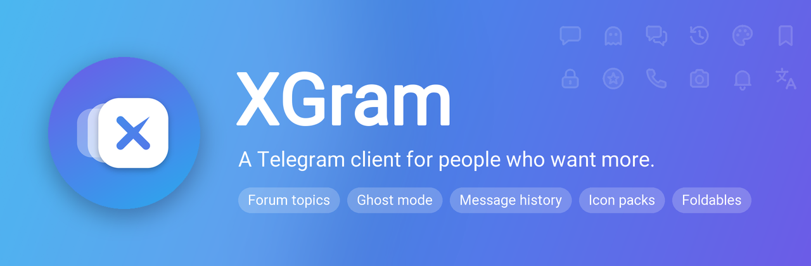
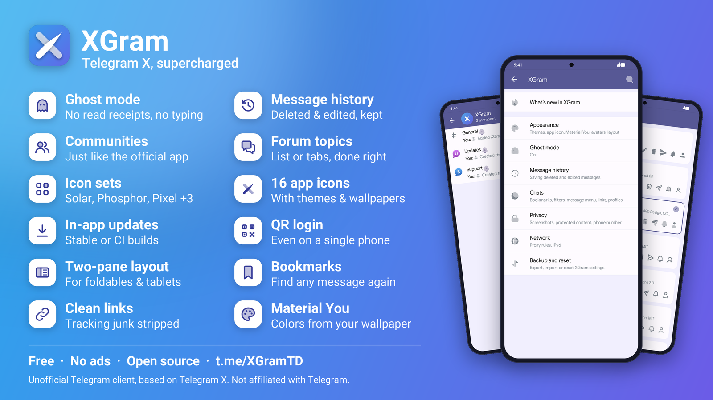
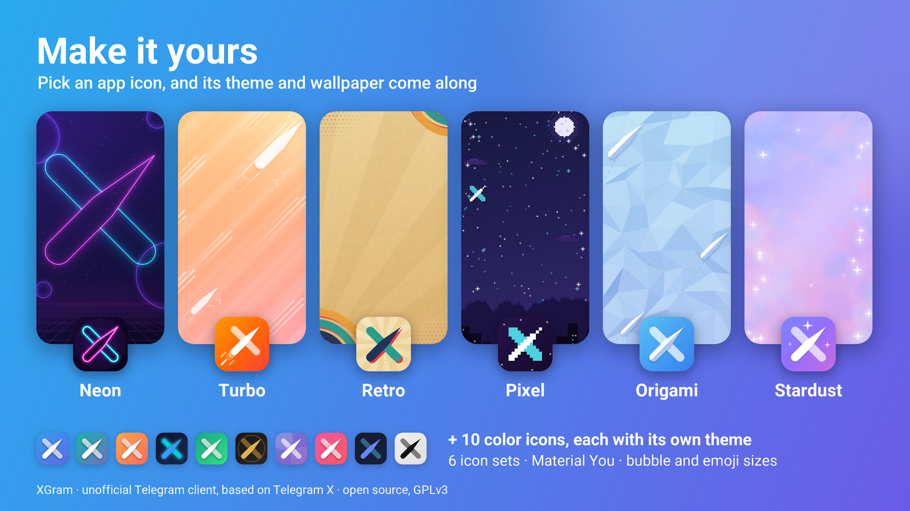

<p align="center">
  
</p>

XGram is an unofficial Telegram client for Android. It starts from [Telegram X](https://github.com/TGX-Android/Telegram-X)
and its [TDLib](https://core.telegram.org/tdlib) core, keeps what makes it quick, and adds the things people usually
move to AyuGram or NagramX for: proper forum topics and communities, ghost mode, a history of deleted and edited
messages, and plenty of small tools and looks.

XGram is not affiliated with Telegram or with the Telegram X team.

<p align="center">
  
</p>

## Download

- **Stable:** the [Updates](https://t.me/XGramTD/3) topic of the [XGram group](https://t.me/XGramTD) on Telegram.
- **CI builds:** the [XGram CI](https://t.me/XGramci) channel, built from the latest commits every other day.

XGram can update itself: pick Stable or CI builds in Settings → XGram → Updates. The group is also the place for
questions, bug reports and ideas.

XGram needs Android 13 or newer: take the arm64-v8a APK for most phones, armeabi-v7a for 32-bit ARM phones. Every
build post lists the SHA-256 of its APK, so you can check what you install.

## What's inside

**Topics and communities**
- Forums open as a topic list, or as tabs like in Telegram, with search, pinning, reordering and a jump to the next mention.
- Unread, mention and reaction counters, read ticks and "typing…" per topic.
- Every topic has its own profile: icon, name, link, notifications and media.
- Create, rename, close, hide and mute topics; share or forward straight into one.
- Telegram communities show as one row in the chat list, with the community's photo and a page listing its chats.
- Pending join requests show on the topic list too, so admins of topic groups see them.

**Privacy**
- Ghost mode: no read receipts, no typing, stay offline, mark as read only when you reply. There's a Quick Settings tile too.
- Screenshots in protected chats (optional), hide your own phone number, keep Android's content capture out.

**Message history**
- Deleted messages stay in the chat, marked with a bin icon, and edited messages keep their earlier versions.
- Kept for 30 days by default (or as long as you like), media included.

**Chats and messages**
- Message filters, shadow bans and hiding blocked users in groups.
- Bookmarks, Saved Messages grouped by chat, local names for people and chats.
- A message menu you can trim, with Repeat, Save to Saved Messages, Copy photo, Reply privately and exact dates and IDs.
- Telegram's own AI tools (summarize, fix spelling, rewrite, translate) where Telegram offers them on your account.
- Pull up at the end of a channel for the next unread one.
- Choose which buttons the message box shows (bot commands, scheduled, camera, voice and video), and optionally tap
  the microphone to start recording instead of holding it.
- Tracking parameters removed from links you open, and working previews for X, Instagram, TikTok, Reddit and Bluesky posts you send.

**Looks**
- Icon packs: XGram Duotone and XGram Line, drawn for XGram, plus Solar, Phosphor, MingCute and Pixel.
- A theme pack, a matching theme for each of the 16 app icons, and Material You colors.
- Chat look: sticker and emoji size, bubble corners and a bubble tail.
- Chat list and chat side by side on unfolded foldables and tablets.

<p align="center">
  
</p>

**Tools**
- Search across all XGram settings; back them up and restore them.
- Updates inside the app, Stable or CI builds, with the changelog and a SHA-256 check.
- Sign in with a QR code you can open, save or share, so a second device isn't needed; email login codes.
- Download boost: files you tap jump the queue and videos load further ahead.
- Proxy rules (off on VPN, Wi-Fi or mobile data), chat export to HTML or text, unblock everyone at once.

## Building

1. Clone with submodules:
   ```sh
   git clone --recursive https://github.com/fahadalijaved/XGram.git
   ```
2. Apply XGram's change to the TDLib submodule:
   ```sh
   bash scripts/xgram-apply-patches.sh
   ```
3. Copy `local.properties.sample` to `local.properties` and fill in `sdk.dir`, `app.id`, `app.name`, your
   `telegram.api_id` and `telegram.api_hash` from [my.telegram.org](https://my.telegram.org), and `keystore.file`
   (a properties file with `keystore.file`, `keystore.password`, `key.alias` and `key.password`).
4. Build from Android Studio, or:
   ```sh
   ./gradlew assembleLatestArm64Debug
   ```

Gradle runs on JDK 25. You also need the Android SDK, NDK `30.0.16248370` and the tools listed in Telegram X's
[build instructions](https://github.com/TGX-Android/Telegram-X#build-instructions) (MSYS2 on Windows). The first build
compiles TDLib, FFmpeg and WebRTC from source, so give it time. For push notifications, replace
`app/google-services.json` with one from your own Firebase project.

## Credits

- [Telegram X](https://github.com/TGX-Android/Telegram-X) by Vyacheslav Krylov and its contributors, which XGram is built on.
- [TDLib](https://github.com/tdlib/td) by Telegram.
- Ideas from [AyuGram](https://github.com/AyuGram), [NagramX](https://github.com/risin42/NagramX) and exteraGram.
- Icon packs: [Solar](https://www.figma.com/community/file/1166831539721848736) by 480 Design (CC BY 4.0),
  [Phosphor](https://phosphoricons.com) (MIT), [MingCute](https://www.mingcute.com) (Apache 2.0) and
  [Pixelarticons](https://pixelarticons.com) by Gerrit Halfmann (MIT). Details in
  [tools/xgram/icon_packs/CREDITS.md](tools/xgram/icon_packs/CREDITS.md).

Made by [Fahad Ali Javed](https://github.com/fahadalijaved).

## Support

XGram is free and has no ads. If you'd like to support its development, you can
[donate via PayPal](https://paypal.me/fahadalijaved23). Thank you! ❤️

## License

XGram is licensed under the GNU General Public License v3.0, like Telegram X. See [LICENSE](LICENSE). Bundled
components keep their own licenses; see [docs/THIRDPARTY.md](docs/THIRDPARTY.md).
